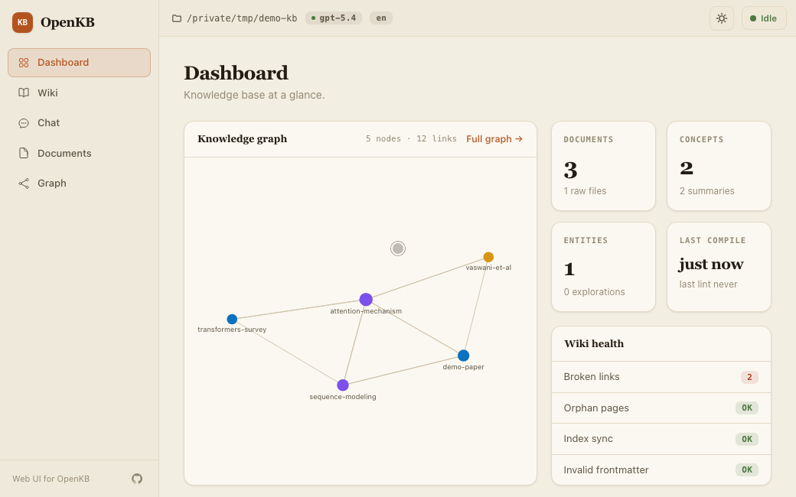
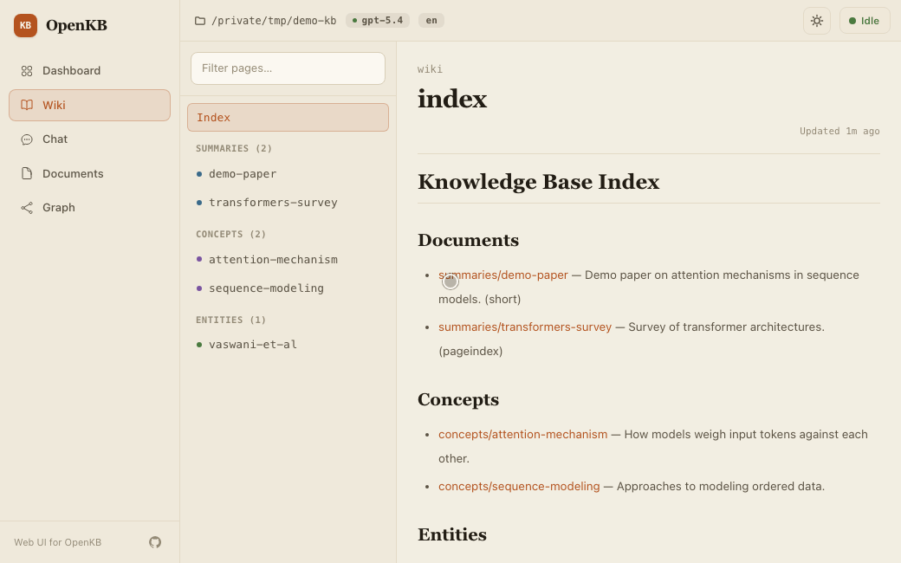
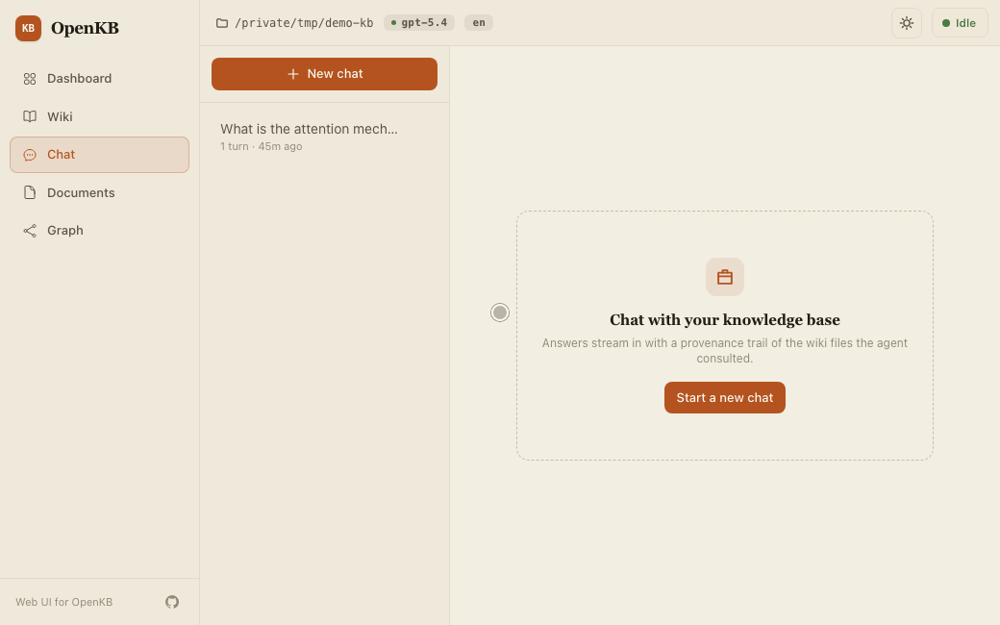
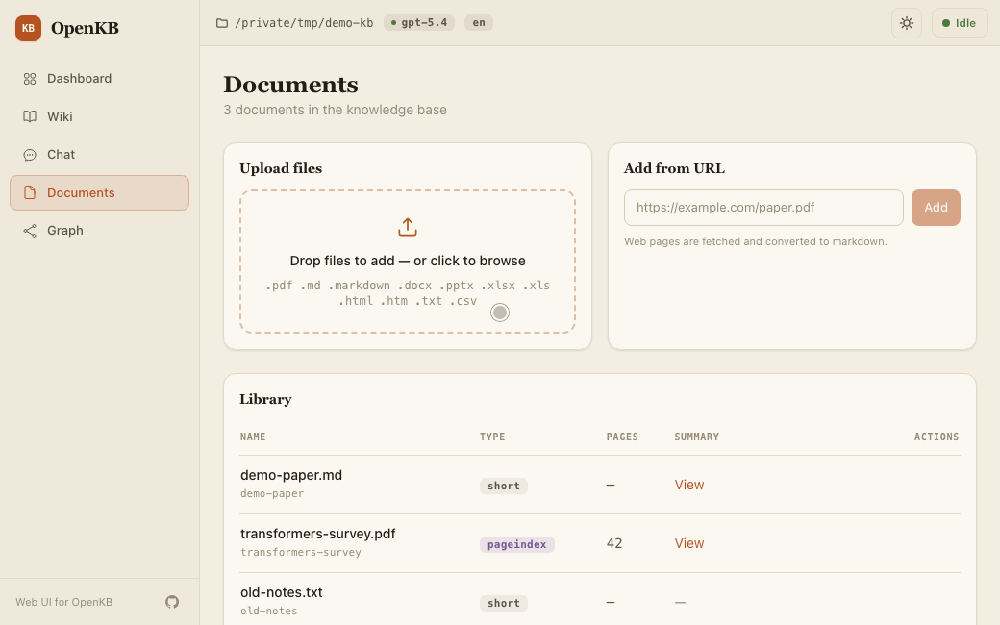
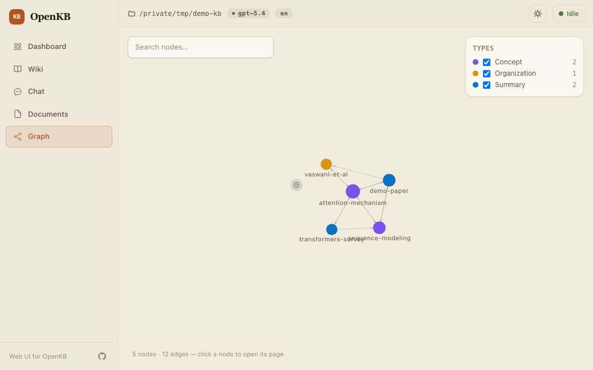

# OpenKB Web UI

[English](README.md) | **한국어** | [简体中文](README.zh-CN.md)

[**OpenKB**](https://github.com/VectifyAI/OpenKB)를 위한 셀프 호스팅 웹 인터페이스입니다.
OpenKB는 문서를 모아 LLM이 관리하는 위키 형태의 지식 베이스로 만들어 주는
오픈소스 도구입니다.



OpenKB는 CLI로만 쓸 수 있고 REST API도 웹 UI도 없습니다. 이 프로젝트는 OpenKB
지식 베이스 하나를 **FastAPI** 백엔드와 **React** 프런트엔드로 감싸서, 브라우저에서
위키를 둘러보고, 위키를 바탕으로 대화하고, 문서를 관리하고, 지식 그래프를 살펴볼
수 있게 해 줍니다.

> 비공식 컴패니언 프로젝트입니다. VectifyAI와는 관련이 없으며 MIT 라이선스로 배포됩니다.

---

## 주요 기능

| 화면 | 하는 일 |
| --- | --- |
| **Dashboard** | 미니 지식 그래프, KB 현황(문서 / 개념 / 엔티티 / 마지막 컴파일), 바로 새 대화를 여는 질문 입력창, `wiki/log.md`에서 읽어 온 활동 내역, 구조 점검 결과(깨진 링크, 고아 페이지, 인덱스 동기화, 잘못된 frontmatter)를 한눈에 보여 줍니다. |
| **Wiki** | 컴파일된 모든 페이지를 종류별로 묶어 보여 줍니다. 마크다운의 `[[wikilinks]]`는 페이지 이동 링크가 됩니다. 연결된 링크는 클릭할 수 있고, 대상이 없는 링크는 흐린 글씨로 표시됩니다. 페이지에 들어 있는 이미지도 그대로 보입니다. |
| **Chat** | 위키를 바탕으로 여러 턴에 걸쳐 스트리밍으로 대화합니다. 답변마다 에이전트가 호출한 도구 내역이 근거로 함께 남습니다. 세션은 OpenKB가 직접 저장하므로 `openkb chat`과 그대로 공유됩니다. 한 번 묻고 끝나는 단발성 query 엔드포인트도 있습니다. |
| **Documents** | 문서 목록 조회, 파일 업로드와 URL 추가, 삭제(실행 전에 dry-run 계획을 보여 주고 확인을 받습니다), 재컴파일을 지원합니다. 모든 작업의 진행 상황은 SSE로 실시간 전달됩니다. |
| **Graph** | OpenKB의 `build_graph()`로 만든 인터랙티브 force-directed 지식 그래프입니다. 노드는 유형별로 색이 다르고, 노드 검색과 유형 필터를 쓸 수 있습니다. 노드를 클릭하면 해당 페이지가 열립니다. |

라이트 테마와 다크 테마를 기본으로 제공합니다.

## 둘러보기

아래 영상은 모두 데모 지식 베이스로 띄운 실제 UI를 녹화한 것입니다
([지식 베이스 없이 체험하기](#지식-베이스-없이-체험하기) 참고).

### Wiki

트리에서 페이지를 고른 뒤 `[[wikilinks]]`를 따라 페이지 사이를 오갑니다.



### Chat

저장된 세션을 다시 열고, 답변에 인용된 페이지를 눌러 위키로 바로 넘어갑니다.
영상에 나오는 세션은 데모 KB에 들어 있는 것이며, 새로 질문하려면 LLM 키가
필요합니다.



### Documents

문서를 삭제하면 먼저 dry-run 계획을 보여 줍니다. 확인하고 나면 작업 로그가
실시간으로 올라옵니다.



### Graph

노드를 검색하고, 유형별로 걸러 보고, 노드를 클릭해 해당 페이지를 엽니다.



## 아키텍처

이 래퍼의 구조는 OpenKB가 만들어진 방식에 맞춰 둘로 나뉩니다.

- **읽기와 채팅은 프로세스 안에서** `openkb` 파이썬 패키지를 직접 호출합니다.
  CLI에는 JSON 출력 모드가 없어서 백엔드가 OpenKB를 직접 import합니다
  (`build_graph`, `frontmatter`, `chat_session`, `lint`, …). 채팅과 query는
  터미널에 묶여 있는 CLI의 `run_chat`/`run_query`를 거치지 않고
  `agents.Runner.run_streamed(...)`를 직접 소비해 이벤트를 Server-Sent Events로
  바꿔 보냅니다.
- **변경 작업은 `openkb` CLI 서브프로세스로** 실행하며, 워커가 하나뿐인 작업 큐를
  거칩니다. `add_single_file`은 내부에서 `asyncio.run()`을 호출하고,
  `_setup_llm_key`는 프로세스 전역 상태를 바꾸며, OpenKB의 advisory 파일 락과
  크래시 복구 저널은 프로세스 경계를 전제로 설계되어 있습니다. 그래서 추가 /
  삭제 / 재컴파일은 KB마다 한 번에 하나씩 별도 프로세스로 실행하고, stdout을
  파싱해 진행 이벤트로 만듭니다. CLI의 종료 코드는 믿을 수 없기 때문에 결과는
  출력에 찍힌 `[OK]`/`[ERROR]`/`[SKIP]` 표시로 판정합니다.

서버 프로세스 하나는 지식 베이스 하나와 자격 증명 컨텍스트 하나만 담당합니다.

```
openkb-web-ui/
├── backend/        FastAPI app (Python ≥3.11, uv-managed) wrapping the openkb package
├── frontend/       Vite + React 18 + TypeScript + Tailwind
├── scripts/        make_demo_kb.py — build a synthetic KB with no LLM calls
└── docs/           design spec, README assets
```

## 빠른 시작

**준비물:** Python ≥ 3.11과 이미 만들어 둔 OpenKB 지식 베이스(`pip install openkb`
후 `openkb init`)가 필요합니다. 채팅, query, 문서 수집에는 OpenKB CLI와 똑같은
방식으로 KB에 `LLM_API_KEY`가 설정되어 있어야 합니다(`<kb>/.env` 또는
`~/.config/openkb/.env`). 위키 열람, 그래프, 현황 조회는 키 없이도 동작합니다.

### PyPI에서 설치 (첫 릴리스부터)

첫 PyPI 릴리스부터는 백엔드와 빌드된 프런트엔드가 `openkb-web`이라는 파이썬
패키지 하나로 배포되므로, Node.js도 소스 체크아웃도 필요 없습니다.

```bash
uvx openkb-web --kb-dir /path/to/your/kb        # run it without installing (uv)
pipx run openkb-web --kb-dir /path/to/your/kb   # same, with pipx

# or install it
pip install openkb-web
openkb-web --kb-dir /path/to/your/kb            # then open http://127.0.0.1:8000
```

그 릴리스가 나오기 전이거나 코드를 직접 고치려면 아래처럼 소스에서 실행하세요.

### 소스에서: 프로덕션 방식 (백엔드가 빌드된 프런트엔드를 서빙)

여기서부터는 [`uv`](https://docs.astral.sh/uv/)와 Node ≥ 20이 필요합니다.

```bash
# 1. Build the frontend
cd frontend
npm install
npm run build

# 2. Run the backend — it serves ../frontend/dist automatically
cd ../backend
uv sync
uv run openkb-web --kb-dir /path/to/your/kb   # then open http://127.0.0.1:8000
```

### 소스에서: 개발 모드 (Vite 개발 서버 + 핫 리로드)

```bash
# Terminal 1 — backend API on :8000
cd backend && uv sync && uv run openkb-web --kb-dir /path/to/your/kb --reload

# Terminal 2 — frontend on :5173, proxying /api to :8000
cd frontend && npm install && npm run dev
```

### 지식 베이스 없이 체험하기

`make_demo_kb.py`는 로컬 파일만으로(LLM 호출 없이) 실제와 비슷한 합성 KB를
만들어 줍니다. 읽기 전용 화면은 전부 바로 살펴볼 수 있습니다.

```bash
# 1. Build the frontend (skip if you already did)
cd frontend && npm install && npm run build

# 2. Create the demo KB and serve it
cd ../backend && uv sync
uv run python ../scripts/make_demo_kb.py /tmp/demo-kb
uv run openkb-web --kb-dir /tmp/demo-kb   # then open http://127.0.0.1:8000
```

## 설정

| 변수 | 용도 |
| --- | --- |
| `--kb-dir` / `OPENKB_WEB_KB_DIR` | 지식 베이스 디렉터리(`.openkb/`가 들어 있어야 합니다). 반드시 직접 지정해야 하며, 상위 디렉터리를 거슬러 올라가며 찾지 않습니다. |
| `--host`, `--port` | 바인드 주소(기본값 `127.0.0.1:8000`). 루프백 주소(`127.0.0.0/8`, `::1`, `localhost`)가 아닌 `--host`는 `0.0.0.0`, `::`를 포함해 접근 토큰을 설정하지 않으면 실행을 거부합니다. |
| `OPENKB_WEB_TOKEN` | 선택 사항인 접근 토큰이며 기본값은 꺼짐입니다. 설정하면 모든 API 요청에 토큰이 필요합니다. 브라우저는 로그인 화면을 한 번 띄운 뒤 HttpOnly 세션 쿠키를 사용하고, API 클라이언트는 `Authorization: Bearer <token>`을 보냅니다. 공백 없는 출력 가능한 ASCII 16자 이상이어야 합니다. |
| `--token-file` / `OPENKB_WEB_TOKEN_FILE` | 접근 토큰을 파일에서 읽습니다. 셸 기록과 서버 환경 변수에 토큰이 남지 않습니다. 토큰 값 자체를 받는 옵션은 일부러 두지 않았습니다(프로세스 목록에 보이기 때문입니다). |
| `OPENKB_WEB_CORS_ORIGINS` | 개발용 프런트엔드에 허용할 origin 목록, 쉼표로 구분(기본값 `http://localhost:5173,http://127.0.0.1:5173`). |
| `OPENKB_WEB_ALLOWED_HOSTS` | `localhost`, `127.0.0.1`, `[::1]`(포트 무관) 외에 추가로 허용할 `Host` 이름 목록, 쉼표로 구분. LAN 호스트 이름이나 리버스 프록시 도메인으로 일부러 서비스할 때 지정합니다(예: `kb.lan,*.example.com`). 그 밖의 `Host`로 들어온 요청은 400으로 거부합니다(DNS 리바인딩 방어). `*`로 지정하면 검사를 끕니다. |

모델, 언어, LLM 자격 증명은 KB 자체의 `.openkb/config.yaml`과 `.env`에서
가져옵니다. 이 UI에서는 관리하지 않습니다.

## 보안 모델

**로컬 단일 사용자용 도구**입니다. 기본 설정에서는 OpenKB CLI와 마찬가지로 인증이
없습니다. `127.0.0.1`에만 바인드하며, 허용 목록에 있는 `Host` 이름으로 온 요청에만
응답하므로(`OPENKB_WEB_ALLOWED_HOSTS` 참고) DNS 리바인딩을 노리는 웹 페이지가
브라우저를 거쳐 접근할 수 없습니다. 그래도 로컬 서버는 브라우저를 통해 접근될 수
있으므로, 상태를 바꾸는 요청은 Origin/same-origin CSRF 검사로 보호하고, 경로
파라미터는 디렉터리 탈출(traversal) 여부를 검사하며, CLI로 넘기는 문서/URL 인자도
검증합니다.

다른 사람이 포트에 접근할 수 있다면 **선택 사항인 접근 토큰**으로 API 전체를 보호할
수 있습니다. 루프백이 아닌 `--host`로 실행할 때는 토큰이 반드시 필요합니다.

```bash
python3 -c 'import secrets; print(secrets.token_urlsafe(32))' > ~/.openkb-web-token
chmod 600 ~/.openkb-web-token
openkb-web --kb-dir /path/to/kb --token-file ~/.openkb-web-token
```

토큰은 사용자 계정이 아니라 하나의 공유 비밀값이고, 서버는 평문 HTTP로 통신하므로
전송 중인 토큰은 보호되지 않습니다. 다른 컴퓨터에서 접속하려면 기본 바인드를
유지한 채 SSH 터널(`ssh -L 8000:127.0.0.1:8000 <host>`)이나 TLS를 종료하는 리버스
프록시를 쓰고, 다른 사람이 포트에 접근할 수 있다면 토큰도 함께 설정하세요.

전체 보안 모델, 알려진 한계, 안전한 배포 방법, 취약점을 비공개로 제보하는 방법은
[SECURITY.md](SECURITY.md)(영문)를 참고하세요. 보안 문제는 공개 이슈로 올리지 말아
주세요.

## 개발

```bash
# Backend tests (synthetic KB fixture, no LLM, no network)
cd backend && uv run pytest -q

# Frontend checks
cd frontend && npx tsc --noEmit && npm run build && npx vitest run

# Python package (sdist + wheel in backend/dist, with the frontend inside)
cd frontend && npm ci && npm run build && cd ../backend && uv build
```

`uv build`는 `frontend/dist`를 패키지 안에 넣으며, 프런트엔드를 먼저 빌드하지
않았다면 실패합니다. 배포는 자동화되어 있습니다. GitHub 릴리스를 게시하면
[`.github/workflows/release.yml`](.github/workflows/release.yml)이 두 파일을
빌드해 PyPI 신뢰할 수 있는 게시(trusted publishing)로 업로드합니다.

## 호환성

`openkb==0.4.3`에 고정되어 있습니다. 프로세스 내 읽기가 OpenKB의 내부 헬퍼 일부
(예: `lint._WIKILINK_RE`)에 의존하기 때문에 버전 고정이 중요합니다. OpenKB의
구조가 바뀌면 이 부분을 다시 손봐야 합니다.

## 다루지 않는 범위 (v1)

한 서버에서 여러 KB 전환, 사용자 계정과 외부 로그인(공유 접근 토큰 하나만
선택적으로 지원합니다), skill/deck 생성기, LLM 기반 의미 lint, Docker 패키징은
지금은 의도적으로 범위에서 뺐습니다.

## 라이선스

MIT — [LICENSE](LICENSE) 참고.
