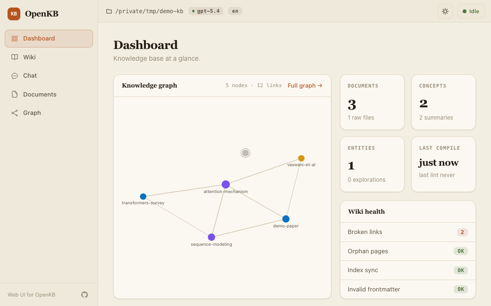
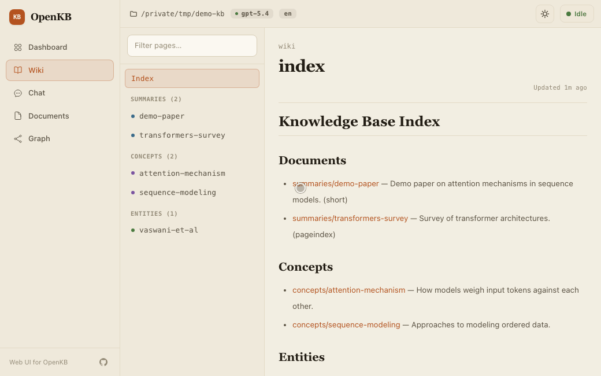
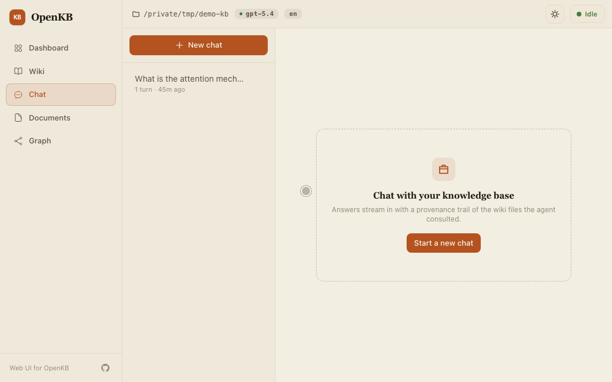
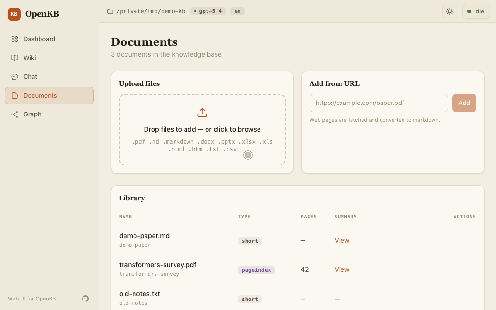
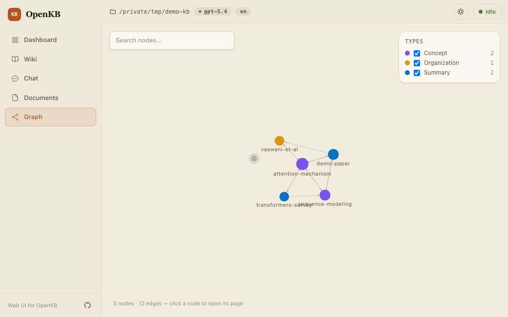

# OpenKB Web UI

**English** | [한국어](README.ko.md) | [简体中文](README.zh-CN.md)

A self-hostable web interface for [**OpenKB**](https://github.com/VectifyAI/OpenKB) —
the open-source tool that compiles your documents into an LLM-maintained,
wiki-style knowledge base.



OpenKB is CLI-only: it has no REST API and no web UI. This project wraps one
OpenKB knowledge base with a **FastAPI** backend and a **React** frontend so you
can browse the wiki, chat over it, manage documents, and explore the knowledge
graph from your browser.

> Unofficial companion project. Not affiliated with VectifyAI. MIT licensed.

---

## Features

| Section | What it does |
| --- | --- |
| **Dashboard** | A mini knowledge graph, KB status (documents / concepts / entities / last compile), an ask box that opens a new chat, an activity feed parsed from `wiki/log.md`, and structural health checks (broken links, orphans, index sync, invalid frontmatter). |
| **Wiki** | Browse every compiled page grouped by kind. Markdown renders with `[[wikilinks]]` turned into navigation — resolved links are clickable, unresolved ones show as muted text — and page images served inline. |
| **Chat** | Streaming, multi-turn chat over the wiki with a per-answer provenance trail of the tool calls the agent made. Sessions are persisted by OpenKB itself, so they're shared with `openkb chat`. Includes a one-shot query endpoint. |
| **Documents** | List documents, upload files or add URLs, remove (with a dry-run plan you confirm), and recompile — all with live job progress streamed over SSE. |
| **Graph** | Interactive force-directed knowledge graph built from OpenKB's own `build_graph()`, colored by node type, with node search and type filters. Click a node to open its page. |

Light and dark themes are built in.

## Tour

Every clip below was recorded from the real UI running on the demo knowledge
base (see [Try it without a knowledge base](#try-it-without-a-knowledge-base)).

### Wiki

Pick a page from the tree, then follow `[[wikilinks]]` from page to page.



### Chat

Reopen a saved session and jump from a cited page straight into the wiki. The
clip shows the session that ships with the demo KB; asking new questions needs
an LLM key.



### Documents

Removing a document shows a dry-run plan first; once you confirm, the job log
streams in live.



### Graph

Search for a node, filter by type, and click a node to open its page.



## Architecture

The wrapper follows a split dictated by how OpenKB is built:

- **Reads and chat run in-process** against the `openkb` Python package. There is
  no JSON output mode in the CLI, so the backend imports OpenKB directly
  (`build_graph`, `frontmatter`, `chat_session`, `lint`, …). Chat and query
  bypass the CLI's terminal-coupled `run_chat`/`run_query` and consume
  `agents.Runner.run_streamed(...)` directly, mapping events to Server-Sent
  Events.
- **Mutations run as `openkb` CLI subprocesses** through a single-worker job
  queue. `add_single_file` calls `asyncio.run()` internally, `_setup_llm_key`
  mutates process-global state, and OpenKB's advisory file lock + crash-recovery
  journal are designed around process boundaries — so add / remove / recompile
  are shelled out one at a time per KB, with stdout parsed into progress events.
  Outcomes are classified by `[OK]`/`[ERROR]`/`[SKIP]` output markers because
  the CLI's exit codes are unreliable.

One server process serves exactly one knowledge base and one credential context.

```
openkb-web-ui/
├── backend/        FastAPI app (Python ≥3.11, uv-managed) wrapping the openkb package
├── frontend/       Vite + React 18 + TypeScript + Tailwind
├── scripts/        make_demo_kb.py — build a synthetic KB with no LLM calls
└── docs/           design spec, README assets
```

## Quick start

**Prerequisites:** Python ≥ 3.11 with [`uv`](https://docs.astral.sh/uv/), Node ≥ 20,
and an existing OpenKB knowledge base (`pip install openkb` then `openkb init`).
Chat, query, and document ingestion need an `LLM_API_KEY` configured for the KB
(in `<kb>/.env` or `~/.config/openkb/.env`) exactly as the OpenKB CLI expects;
browsing, the graph, and status work without one.

### Production-style (backend serves the built frontend)

```bash
# 1. Build the frontend
cd frontend
npm install
npm run build

# 2. Run the backend — it serves ../frontend/dist automatically
cd ../backend
uv sync
uv run openkb-web --kb-dir /path/to/your/kb   # then open http://127.0.0.1:8000
```

### Development (Vite dev server + hot reload)

```bash
# Terminal 1 — backend API on :8000
cd backend && uv sync && uv run openkb-web --kb-dir /path/to/your/kb --reload

# Terminal 2 — frontend on :5173, proxying /api to :8000
cd frontend && npm install && npm run dev
```

### Try it without a knowledge base

`make_demo_kb.py` builds a realistic synthetic KB entirely from local files (no
LLM calls), so you can explore every read-only screen immediately:

```bash
# 1. Build the frontend (skip if you already did)
cd frontend && npm install && npm run build

# 2. Create the demo KB and serve it
cd ../backend && uv sync
uv run python ../scripts/make_demo_kb.py /tmp/demo-kb
uv run openkb-web --kb-dir /tmp/demo-kb   # then open http://127.0.0.1:8000
```

## Configuration

| Variable | Purpose |
| --- | --- |
| `--kb-dir` / `OPENKB_WEB_KB_DIR` | Knowledge base directory (must contain `.openkb/`). Explicit only — no walk-up discovery. |
| `--host`, `--port` | Bind address (default `127.0.0.1:8000`). |
| `OPENKB_WEB_CORS_ORIGINS` | Comma-separated allowed origins for the dev frontend (default `http://localhost:5173,http://127.0.0.1:5173`). |
| `OPENKB_WEB_ALLOWED_HOSTS` | Comma-separated extra `Host` names to serve, on top of `localhost`, `127.0.0.1` and `[::1]` (any port) — set it when you deliberately serve the UI under a LAN name or behind a reverse proxy (e.g. `kb.lan,*.example.com`). Requests with any other `Host` get 400 (DNS-rebinding guard); `*` turns the check off. |

The model, language, and LLM credentials come from the KB's own
`.openkb/config.yaml` and `.env` — this UI does not manage them.

## Security model

This is a **local, single-user tool** with no authentication, same as the OpenKB
CLI. It binds to `127.0.0.1` by default and only answers to allowlisted `Host`
names (see `OPENKB_WEB_ALLOWED_HOSTS`), so a DNS-rebinding page cannot reach it
through your browser. Because an unauthenticated local server is still reachable
from a browser, state-changing requests are protected by an
Origin/same-origin CSRF guard, path parameters are traversal-checked, and
document/URL arguments passed to the CLI are validated. Do not expose it to an
untrusted network.

## Development

```bash
# Backend tests (synthetic KB fixture, no LLM, no network)
cd backend && uv run pytest -q

# Frontend checks
cd frontend && npx tsc --noEmit && npm run build && npx vitest run
```

## Compatibility

Pinned to `openkb==0.4.3`. The in-process reads depend on some of OpenKB's
internal helpers (e.g. `lint._WIKILINK_RE`), so the version pin matters — expect
to revisit it when OpenKB changes its layout.

## Non-goals (v1)

Multi-KB switching in one server, authentication, the skill/deck generators,
LLM-based semantic lint, and Docker packaging are intentionally out of scope for
now.

## License

MIT — see [LICENSE](LICENSE).
