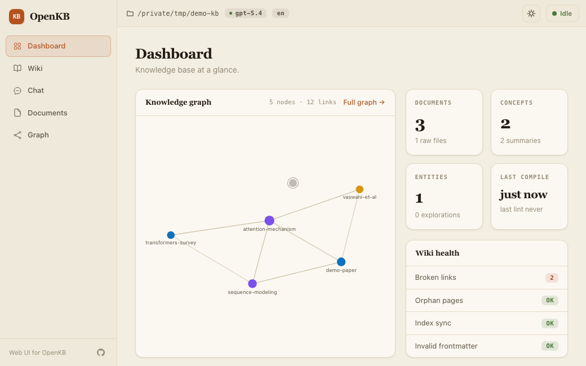
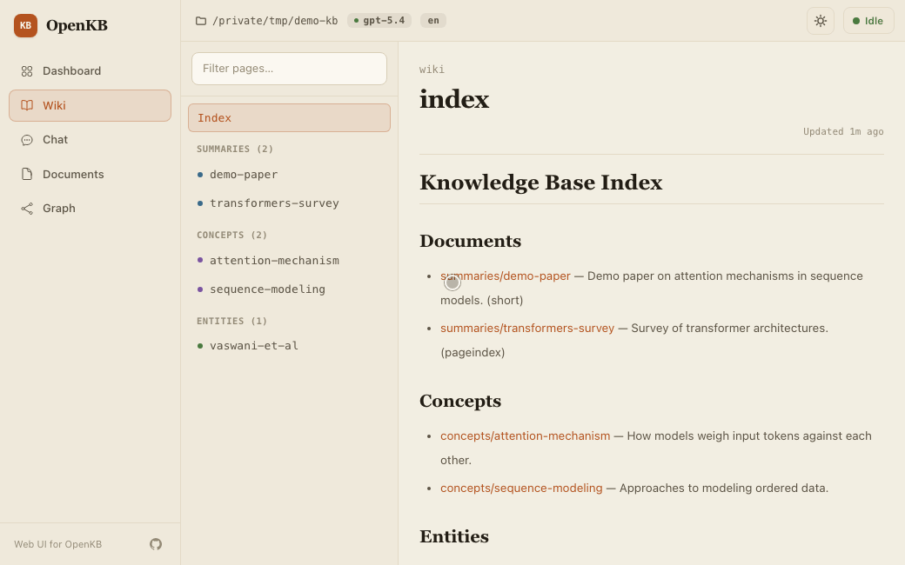
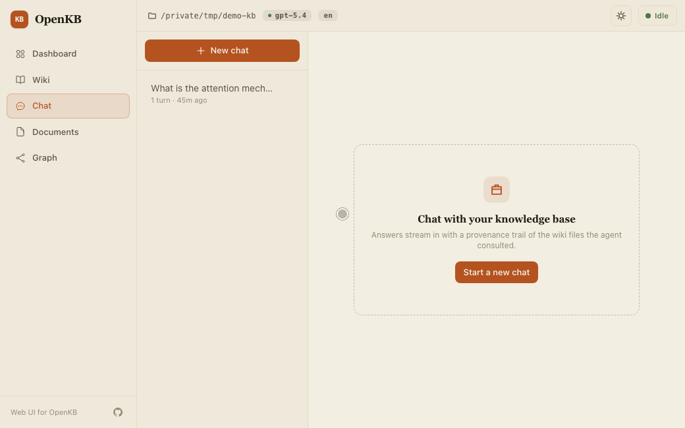
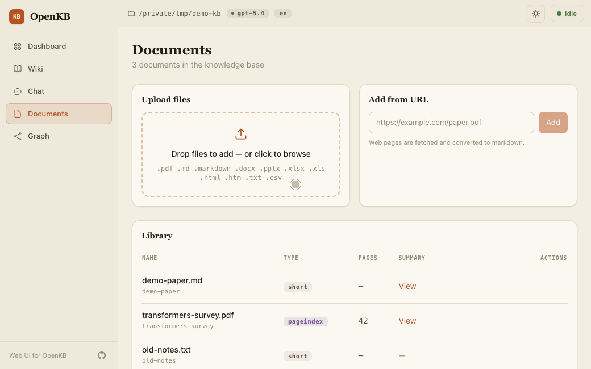
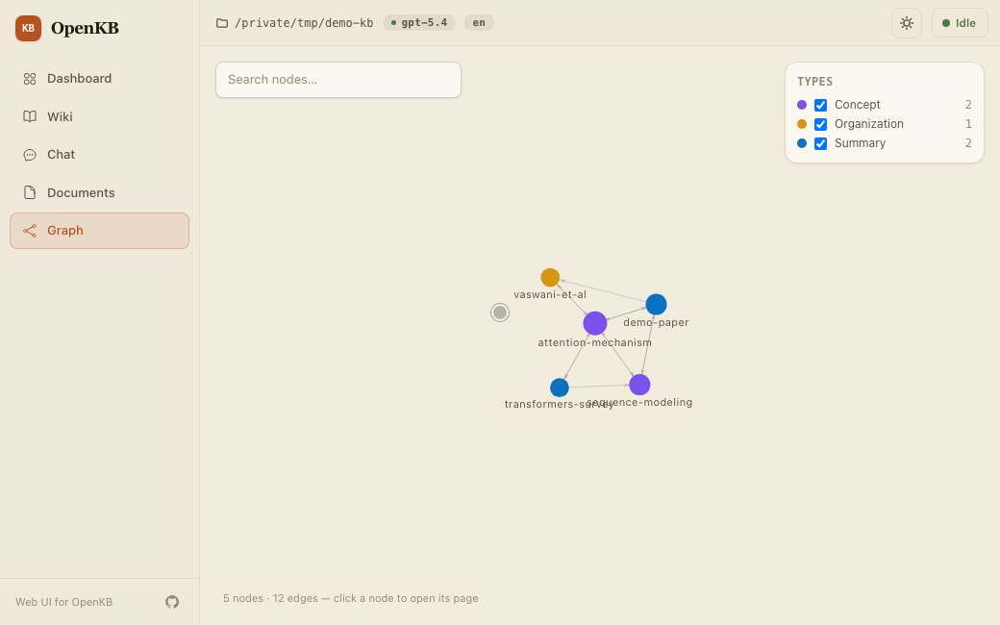

# OpenKB Web UI

[English](README.md) | [한국어](README.ko.md) | **简体中文**

为 [**OpenKB**](https://github.com/VectifyAI/OpenKB) 打造的可自托管 Web 界面。
OpenKB 是一款开源工具，能把你的文档编译成由 LLM 维护的 wiki 式知识库。



OpenKB 只有命令行，没有 REST API，也没有 Web 界面。本项目用 **FastAPI** 后端和
**React** 前端把一个 OpenKB 知识库包装起来，让你在浏览器里就能浏览 wiki、基于
wiki 对话、管理文档、探索知识图谱。

> 非官方配套项目，与 VectifyAI 无关。采用 MIT 许可证。

---

## 功能

| 页面 | 用途 |
| --- | --- |
| **Dashboard** | 迷你知识图谱、知识库概况（文档 / 概念 / 实体 / 上次编译时间）、可直接开启新对话的提问框、从 `wiki/log.md` 解析出的活动记录，以及结构健康检查（失效链接、孤立页面、索引同步、无效 frontmatter）。 |
| **Wiki** | 按类型分组浏览所有编译好的页面。Markdown 中的 `[[wikilinks]]` 会渲染成导航链接：能解析的可以点击，解析不到的显示为灰色文字；页面里的图片也会直接显示。 |
| **Chat** | 基于 wiki 的流式多轮对话，每条回答都附带智能体调用工具的记录，方便追溯来源。会话由 OpenKB 自己保存，因此和 `openkb chat` 是互通的。另外还提供一个一次性的 query 接口。 |
| **Documents** | 查看文档列表、上传文件或添加 URL、删除（先给出 dry-run 计划，确认后才执行）、重新编译；所有任务的进度都通过 SSE 实时推送。 |
| **Graph** | 基于 OpenKB 自带的 `build_graph()` 构建的交互式力导向知识图谱，节点按类型着色，支持节点搜索和类型筛选。点击节点即可打开对应页面。 |

内置浅色和深色两套主题。

## 功能演示

下面的动图都是在演示知识库上运行真实界面时录制的
（参见[没有知识库也能试用](#没有知识库也能试用)）。

### Wiki

在目录树里选一个页面，然后顺着 `[[wikilinks]]` 在页面之间跳转。



### Chat

重新打开已保存的会话，点击回答中引用的页面即可直接跳到 wiki。动图里的会话是
演示知识库自带的；要提出新问题，需要配置 LLM 密钥。



### Documents

删除文档时会先展示 dry-run 计划；确认之后，任务日志会实时输出。



### Graph

搜索节点、按类型筛选，点击节点打开对应页面。



## 架构

这层封装之所以分成两部分，是由 OpenKB 自身的实现方式决定的：

- **读取和对话在进程内完成**，直接调用 `openkb` Python 包。CLI 没有 JSON 输出
  模式，所以后端直接 import OpenKB（`build_graph`、`frontmatter`、
  `chat_session`、`lint` 等）。对话和 query 绕开了 CLI 中与终端耦合的
  `run_chat`/`run_query`，直接消费 `agents.Runner.run_streamed(...)`，再把事件
  转成 Server-Sent Events。
- **写操作以 `openkb` CLI 子进程的方式执行**，并经过一个单 worker 的任务队列。
  `add_single_file` 内部会调用 `asyncio.run()`，`_setup_llm_key` 会修改进程级
  全局状态，而 OpenKB 的 advisory 文件锁和崩溃恢复日志也都是按进程边界设计的。
  因此添加 / 删除 / 重新编译会交给子进程，每个知识库一次只跑一个，并把 stdout
  解析成进度事件。由于 CLI 的退出码不可靠，任务结果是根据输出中的
  `[OK]`/`[ERROR]`/`[SKIP]` 标记来判定的。

一个服务进程只服务一个知识库和一套凭据上下文。

```
openkb-web-ui/
├── backend/        FastAPI app (Python ≥3.11, uv-managed) wrapping the openkb package
├── frontend/       Vite + React 18 + TypeScript + Tailwind
├── scripts/        make_demo_kb.py — build a synthetic KB with no LLM calls
└── docs/           design spec, README assets
```

## 快速开始

**环境要求：** Python ≥ 3.11，以及一个已有的 OpenKB 知识库（先 `pip install openkb`，
再 `openkb init`）。对话、query 和文档导入需要为知识库配置 `LLM_API_KEY`（放在
`<kb>/.env` 或 `~/.config/openkb/.env` 中），做法和 OpenKB CLI 完全一样；浏览
wiki、查看图谱和状态则不需要密钥。

### 从 PyPI 安装（自首个版本起）

从首个 PyPI 版本起，整个应用（后端加上构建好的前端）作为一个 Python 包
`openkb-web` 发布，既不需要 Node.js，也不需要源码：

```bash
uvx openkb-web --kb-dir /path/to/your/kb        # run it without installing (uv)
pipx run openkb-web --kb-dir /path/to/your/kb   # same, with pipx

# or install it
pip install openkb-web
openkb-web --kb-dir /path/to/your/kb            # then open http://127.0.0.1:8000
```

在该版本发布之前，或者想修改代码时，请按下面的方式从源码运行。

### 从源码：生产方式（由后端托管构建好的前端）

以下方式需要 [`uv`](https://docs.astral.sh/uv/) 和 Node ≥ 20。

```bash
# 1. Build the frontend
cd frontend
npm install
npm run build

# 2. Run the backend — it serves ../frontend/dist automatically
cd ../backend
uv sync
uv run openkb-web --kb-dir /path/to/your/kb   # then open http://127.0.0.1:8000
```

### 从源码：开发模式（Vite 开发服务器 + 热更新）

```bash
# Terminal 1 — backend API on :8000
cd backend && uv sync && uv run openkb-web --kb-dir /path/to/your/kb --reload

# Terminal 2 — frontend on :5173, proxying /api to :8000
cd frontend && npm install && npm run dev
```

### 没有知识库也能试用

`make_demo_kb.py` 只用本地文件（不调用 LLM）就能生成一个相当逼真的合成知识库，
所有只读页面都可以马上体验：

```bash
# 1. Build the frontend (skip if you already did)
cd frontend && npm install && npm run build

# 2. Create the demo KB and serve it
cd ../backend && uv sync
uv run python ../scripts/make_demo_kb.py /tmp/demo-kb
uv run openkb-web --kb-dir /tmp/demo-kb   # then open http://127.0.0.1:8000
```

## 配置

| 变量 | 说明 |
| --- | --- |
| `--kb-dir` / `OPENKB_WEB_KB_DIR` | 知识库目录（其中必须包含 `.openkb/`）。必须显式指定，不会向上级目录自动查找。 |
| `--host`、`--port` | 监听地址（默认 `127.0.0.1:8000`）。 |
| `OPENKB_WEB_CORS_ORIGINS` | 允许开发前端访问的 origin 列表，用逗号分隔（默认 `http://localhost:5173,http://127.0.0.1:5173`）。 |
| `OPENKB_WEB_ALLOWED_HOSTS` | 除 `localhost`、`127.0.0.1`、`[::1]`（任意端口）之外额外允许的 `Host` 名称，用逗号分隔；有意通过局域网主机名或反向代理域名提供服务时设置（例如 `kb.lan,*.example.com`）。其他 `Host` 的请求一律返回 400（防御 DNS 重绑定）；设为 `*` 则关闭该检查。 |

模型、语言和 LLM 凭据都来自知识库自己的 `.openkb/config.yaml` 和 `.env`，本界面
不负责管理这些配置。

## 安全模型

这是一个**本地单用户工具**，和 OpenKB CLI 一样不做身份验证，默认只监听
`127.0.0.1`，并且只响应 `Host` 在允许列表中的请求（见 `OPENKB_WEB_ALLOWED_HOSTS`），
因此利用 DNS 重绑定的网页无法借助浏览器访问它。不过，即使是本地的无认证服务，
浏览器里的网页也能向它发请求，所以会
改变状态的请求都受 Origin/同源 CSRF 检查保护，路径参数会做目录穿越检查，传给
CLI 的文档/URL 参数也会经过校验。请不要把它暴露在不可信的网络中。

完整的安全模型、已知局限、安全部署建议，以及如何私下报告漏洞，请参阅
[SECURITY.md](SECURITY.md)（英文）。请不要在公开 issue 中报告安全问题。

## 开发

```bash
# Backend tests (synthetic KB fixture, no LLM, no network)
cd backend && uv run pytest -q

# Frontend checks
cd frontend && npx tsc --noEmit && npm run build && npx vitest run

# Python package (sdist + wheel in backend/dist, with the frontend inside)
cd frontend && npm ci && npm run build && cd ../backend && uv build
```

`uv build` 会把 `frontend/dist` 打包进去；如果还没有构建前端，构建会直接失败。
发布已经自动化：在 GitHub 上发布 release 时，
[`.github/workflows/release.yml`](.github/workflows/release.yml) 会构建这两个文件，
并通过 PyPI 可信发布（trusted publishing）上传。

## 兼容性

依赖固定为 `openkb==0.4.3`。进程内的读取用到了 OpenKB 的一些内部辅助函数（例如
`lint._WIKILINK_RE`），所以版本固定很重要；OpenKB 调整内部结构时，这里也需要
跟着调整。

## 暂不支持（v1）

单个服务内切换多个知识库、身份验证、skill/deck 生成器、基于 LLM 的语义 lint，
以及 Docker 打包，目前都有意不在范围之内。

## 许可证

MIT，详见 [LICENSE](LICENSE)。
