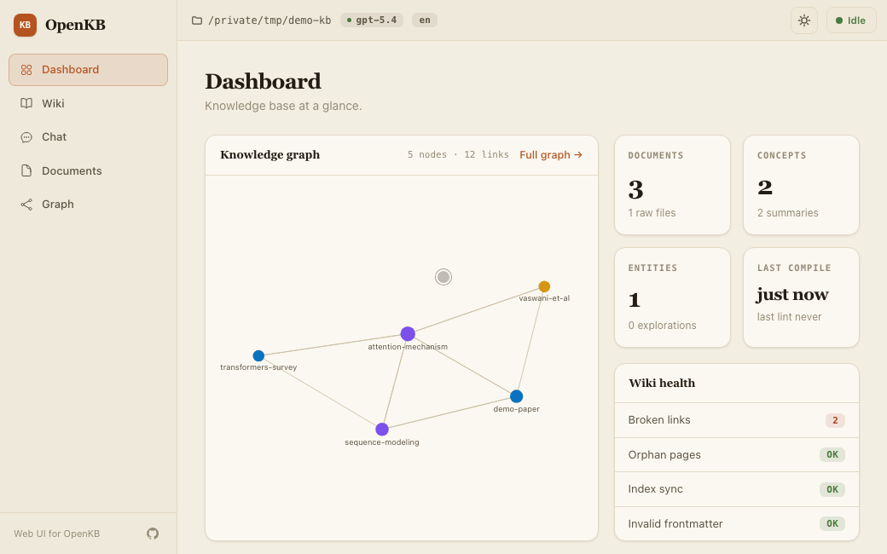

# openkb-web

A self-hostable web UI for [OpenKB](https://github.com/VectifyAI/OpenKB), the
open-source tool that compiles your documents into an LLM-maintained, wiki-style
knowledge base. Browse the wiki, chat over it, manage documents, and explore the
knowledge graph from your browser.

This package contains the FastAPI backend **and** the built React frontend, so
it runs with Python alone: no Node.js and no source checkout.



> Unofficial companion project. Not affiliated with VectifyAI. MIT licensed.

The [project README](https://github.com/josephleee/openkb-web-ui#readme) has the
full feature tour, the architecture, and translations
([한국어](https://github.com/josephleee/openkb-web-ui/blob/main/README.ko.md),
[简体中文](https://github.com/josephleee/openkb-web-ui/blob/main/README.zh-CN.md)).

## Install and run

You need Python ≥ 3.11 and an existing OpenKB knowledge base
(`pip install openkb` then `openkb init`).

From the first PyPI release of `openkb-web` on (until then, run it
[from source](https://github.com/josephleee/openkb-web-ui#quick-start)):

```bash
uvx openkb-web --kb-dir /path/to/your/kb        # run it without installing (uv)
pipx run openkb-web --kb-dir /path/to/your/kb   # same, with pipx

# or install it
pip install openkb-web
openkb-web --kb-dir /path/to/your/kb            # then open http://127.0.0.1:8000
```

Chat, query, and document ingestion need an `LLM_API_KEY` configured for the KB
(in `<kb>/.env` or `~/.config/openkb/.env`) exactly as the OpenKB CLI expects;
browsing, the graph, and status work without one.

| Option | Purpose |
| --- | --- |
| `--kb-dir` / `OPENKB_WEB_KB_DIR` | Knowledge base directory (must contain `.openkb/`). Explicit only, no walk-up discovery. |
| `--host`, `--port` | Bind address (default `127.0.0.1:8000`). |
| `OPENKB_WEB_ALLOWED_HOSTS` | Extra `Host` names to serve besides `localhost`, `127.0.0.1` and `[::1]`, e.g. a LAN name or a reverse proxy (`kb.lan,*.example.com`). Anything else gets 400 (DNS-rebinding guard). |
| `OPENKB_WEB_CORS_ORIGINS` | Allowed origins for a separately served frontend (default: the Vite dev server on `:5173`). |

This is a **local, single-user tool with no authentication**, like the OpenKB
CLI. Do not expose it to an untrusted network. See the
[security policy](https://github.com/josephleee/openkb-web-ui/blob/main/SECURITY.md)
for the full model and how to report a vulnerability.

## Working on the backend

This directory is the Python project. From a source checkout:

```bash
uv sync
uv run openkb-web --kb-dir /path/to/your/kb        # or set OPENKB_WEB_KB_DIR
uv run pytest -q                                   # synthetic KB, no LLM, no network
```

The server wraps exactly one OpenKB knowledge base:

- **Reads + chat** run in-process against the `openkb` package (there is no
  JSON CLI output mode), under OpenKB's shared read lock.
- **Mutations** (add / remove / recompile) run as `openkb` CLI subprocesses
  through a single-worker job queue, with stdout parsed into SSE progress
  events. Outcomes are classified by `[OK]`/`[ERROR]`/`[SKIP]` output markers
  because exit codes are unreliable.

Uploads are staged at `<kb>/.openkb-web-uploads/<original-name>` (outside
`wiki/`). The path is kept stable per filename on purpose: OpenKB identifies a
document by its source path, so re-uploading the same filename overwrites the
document in place instead of forking a `<stem>-<hash>` duplicate.

The server serves the built UI with an SPA fallback from the first of these
that exists: the copy bundled in the installed package (`openkb_web/static/`),
then `../frontend/dist` in a source checkout. With neither, it serves the API
only; run the Vite dev server against `http://127.0.0.1:8000` (CORS for
`localhost:5173` is enabled by default, override with
`OPENKB_WEB_CORS_ORIGINS`).

For a KB to develop against without any LLM calls:

```bash
uv run python ../scripts/make_demo_kb.py /tmp/demo-kb
uv run openkb-web --kb-dir /tmp/demo-kb
```

## Building the package

The sdist and wheel embed the built frontend, so build it first:

```bash
cd ../frontend && npm ci && npm run build
cd ../backend && uv build        # -> dist/openkb_web-<version>.tar.gz and .whl
```

`hatch_build.py` copies `../frontend/dist` into both as `openkb_web/static/`
and fails the build when it is missing, so a package without the UI is never
produced. Editable installs (`uv sync`, `pip install -e`) skip that step and use
the checkout instead. Releases are built and published to PyPI by
`.github/workflows/release.yml` when a GitHub release is published.
